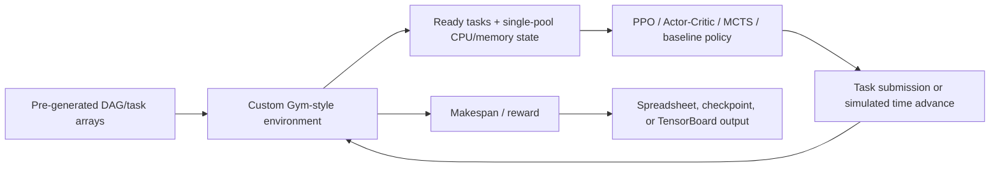

# Project Overview

## Project identity

**Original repository title:** Cloud Workflow Scheduling Based on Deep Reinforcement Learning  
**Research direction:** Intelligent co-scheduling of Kubernetes pods and application tasks in heterogeneous Edge–Cloud clusters  
**Repository:** <https://github.com/maissayahyaoui3-source/Cloud-Workflow-Scheduling-base-on-Deep-Reinforcement-Learning>  
**Inspected version:** commit `eb246ebba160567277c9c1aa226e359f48629dac`  
**Current implementation status:** The original single-resource environment and registered `gym.make()` smoke paths have been exercised; PPO training/evaluation remain unverified. A separate Edge–Cloud discrete-event simulator now supports heterogeneous nodes, task-scoped pod lifecycles, network delay, fresh/stale capacity observations, three fresh-state heuristics, and a delayed-observation variant. It is not a Kubernetes deployment.

## Scientific context and problem

The original code addresses the scheduling of tasks whose precedence relationships form a directed acyclic graph (DAG). A task may become ready only after its parent tasks have completed. Ready tasks request an execution duration and two abstract resources, CPU and memory. The primary environment, `Envs/clusterEnv.py`, models one fixed-capacity compute resource and allows tasks to run concurrently when their combined requirements fit.

The master's research problem is broader: jointly decide which pod should host an application task and which heterogeneous Edge or Cloud node should run that pod, while considering resource constraints, DAG dependencies, communication costs, workload and information uncertainty. The original code does not currently implement those cluster and Kubernetes concepts.

## Research questions to investigate

These are research questions for the proposed project, not conclusions already established by this repository:

1. How does joint task-to-pod assignment and pod-to-node placement affect application completion time compared with separate decisions?
2. How do CPU/memory heterogeneity and Edge–Cloud communication latency change scheduling choices?
3. Can a transparent heuristic provide a useful baseline before introducing a learning-based policy?
4. How robust is scheduling when the observed node state is delayed or incomplete?

## Original repository functionality

The README identifies the project as an undergraduate thesis implementation for cloud workflow scheduling. The checked-in code includes:

- Random DAG and task-workload generation in `DAGs_Generator.py`.
- Custom Gym-style environments in `Envs/`.
- A fixed resource pool with CPU and memory capacities and simulated task execution in `Envs/clusterEnv.py`.
- PPO training/testing scripts (`PPOagent.py`, `PPOtest.py`) and a graph/GCN variant (`PPOagentForGCN.py`, `PPOtestForGCN.py`).
- A separate Actor-Critic path (`DRLagent.py`, `DRL_test.py`).
- MCTS experiment scripts (`MonteCarloTreeSearch.py`, `AblationExperiment.py`).
- Random, SJF, and Tetris-like baseline methods in `baselines_tableau.py`.
- Pre-generated NumPy arrays, model weights, spreadsheets, figures, and TensorBoard event data.

The README describes makespan as an evaluation target and discusses policy rewards. Existing spreadsheet and figure files cannot be treated as reproduced results until their experiment commands, parameter settings, and provenance are verified.

## Current state versus the master's objective

No research scheduling modification has been made. The original workflow scheduler remains intact. Narrow execution/measurement fixes were made to `Envs/clusterEnv.py`: dataset paths are repository-relative, an unused import of a missing helper was removed, incomplete episodes return `False`, and the terminal observation now reports the final simulator time. `Envs/registration.py` registers the legacy `clusterEnv-v0` ID for cluster-based scripts. The final-completion reward still returns zero, so RL cumulative return omits the last completion interval; this remains a documented limitation. Other execution blockers remain.

| Capability | Original repository | Master's project status |
|---|---|---|
| DAG task dependencies | Present in the simulation. | Reuse may be possible after baseline restoration. |
| CPU/memory demand | Present for tasks on a single fixed-capacity resource. | Needs node-specific capacity and allocation. |
| Heterogeneous nodes | Not present. | Implemented in separate simulator. |
| Edge and Cloud tiers | Not present. | Implemented as abstract node tiers. |
| Kubernetes-inspired pods | Not present. | Task-scoped resource records and lifecycle only; no container runtime. |
| Task-to-pod assignment | Not present. | One task-scoped pod record per task. |
| Pod-to-node placement | Not present. | Simulated node placement and CPU/memory reservation. |
| Joint co-scheduling | Not present. | Prototype task/node policies in separate simulator. |
| Network latency / data transfer | Not confirmed in the source model. | Simplified configurable latency/bandwidth; no contention/overlap. |
| Partial or stale cluster observations | Not present. | Fixed-delay capacity snapshot option; no noise or packet loss. |
| RL and heuristic methods | Separate research scripts exist. | Not yet reproduced or compared in this environment. |
| Reproducible evaluation | Some artifacts and makespan scripts exist. | Seeded CSV experiment harness and tests exist; results remain exploratory. |

## Actual system workflow in the checked-in code

The following describes the source-level design; execution is not currently verified:

1. A custom environment loads edge lists, task durations, and CPU/memory demands from NumPy arrays.
2. `reset()` initializes a single compute pool with fixed CPU and memory capacities, constructs the ready-task list from DAG predecessors, and builds an observation vector.
3. A policy or baseline selects a ready task to start, or chooses the special action that advances simulated time by completing the pending task with the least remaining duration.
4. The environment releases the completed task's resources and updates the DAG-ready set.
5. Evaluation scripts read the elapsed simulated time as a makespan and may write spreadsheet output.

There is no actual cluster initialization, pod creation, Kubernetes interaction, or network transfer simulation in this workflow.

## Main files and outputs

| File/folder | Role |
|---|---|
| `DAGs_Generator.py` | Generates layered DAGs with task durations and demands. |
| `Envs/clusterEnv.py` | Main fixed-resource scheduling simulation. |
| `Envs/myEnv.py` | Alternate environment used by the Actor-Critic path. |
| `Envs/graphEnv.py` | Graph embedding environment using `GCNutils/` and saved initial weights. |
| `PPOagent.py` / `PPOtest.py` | PPO training and checkpoint evaluation for `clusterEnv-v0`. |
| `PPOagentForGCN.py` / `PPOtestForGCN.py` | PPO training and test for the GCN environment. |
| `DRLagent.py` / `DRL_test.py` | Actor-Critic train/test path. |
| `baselines_tableau.py` | Random, SJF, and Tetris-like baseline code. |
| `MonteCarloTreeSearch.py`, `AblationExperiment.py` | MCTS experiment scripts. |
| `npy/` | Pre-generated DAG edge, duration, and demand arrays. |
| `runs/PPO_preTrained/`, `models/`, `runs/` | Existing checkpoints and TensorBoard logs; provenance remains unverified. |
| `data/`, `figure/` | Existing spreadsheet and graph artifacts; not reproduced during this analysis. |

Expected output names are hard-coded in scripts, including PPO checkpoint files under `runs/PPO_preTrained/`, Excel files under `data/`, and TensorBoard event files under `runs/`. A successful output is not guaranteed until the runtime and source-level blockers are addressed.

## Setup and execution status

The README specifies Python 3.9.7, PyTorch 1.10, Gym 0.21.0, and NetworkX 2.6.3, but the repository does not include a dependency lockfile or complete dependency list. This machine has Python 3.12.0 and PyTorch 2.11.0+cpu, NumPy 2.4.4, NetworkX 3.6.1, and SciPy 1.17.1. An external Python 3.12 venv was created with system-site packages and Gym 0.26.2, `xlwt` 1.3.0, and `xlsxwriter` 3.3.4 installed. Gym warns that it is unmaintained and does not support NumPy 2.x. Matplotlib download timed out and a TensorBoard wheel download stalled and was cancelled; neither is installed.

The original direct environment smoke test loads the committed 30-task dataset, completes a full DAG, and confirms that the terminal observation time matches the simulator clock. A smoke-valid-action policy and the repository's SJF helper have each completed a 30-task episode; their observed makespans vary because workflow selection is random. These single episodes validate functionality only and do not support comparative scientific claims. The cluster-based `gym.make()` entry point now works through the compatibility registration helper; PPO/baseline full experiment scripts remain unverified. The terminal RL reward for the last completion also remains zero, so no training conclusion is claimed.

## Scientific relevance and limitations

The most defensible role of this repository is a **candidate baseline for DAG-based task scheduling on one abstract multi-resource compute pool**. It may provide reusable task/DAG representations and an initial makespan-oriented simulation. It is not a current implementation of pod scheduling or Edge–Cloud resource placement.

Technical limitations include missing utilities in some environment modules, unresolved Gym registrations for `MyEnv-v0` and `graphEnv-v0`, hard-coded paths in other environments, old dependency APIs, and no automated tests. Modeling limitations include one fixed-capacity resource, no pod abstraction, no node heterogeneity, no network delay, no multi-application contention model, and no stale observations. The active DAG generator also differs from some README workload descriptions; the generated distributions should be checked directly before experiments. Scientific limitations include unclear experiment provenance, undocumented random seeds/configuration, and not-yet-reproduced reported comparisons.

Any future contribution should first restore the original behavior and produce a reproducible baseline. A simulation of Kubernetes concepts must be labelled as a simulator; it is not equivalent to a real Kubernetes deployment. Claims about improved performance or novelty require controlled experiments and appropriate related-work analysis.

## Architecture and research proposal documents

- [`SYSTEM_ARCHITECTURE.md`](SYSTEM_ARCHITECTURE.md) documents the original source and the separate simulator prototype.
- [`RESEARCH_GAP.md`](RESEARCH_GAP.md) maps the research requirements to existing capabilities, gaps, and staged effort.
- [`PROPOSED_APPROACH.md`](PROPOSED_APPROACH.md) documents implemented simulator capabilities, assumptions, validation, and remaining gaps.
