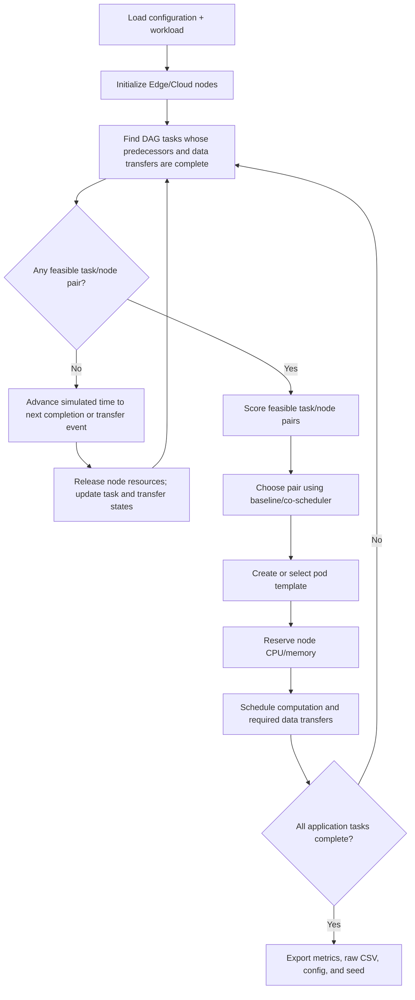

# Proposed Approach: Simulated Edge–Cloud Co-Scheduling

## Status

The isolated simulator prototype is implemented in `Envs/edge_cloud_simulator.py` with deterministic tests in `tests/test_edge_cloud_simulator.py`. It does not replace the original scheduler. Network contention, reusable pods, and noisy telemetry remain out of scope.

The original workflow simulator in `Envs/clusterEnv.py` remains a candidate baseline and is not to be silently replaced. The proposed system is a **Kubernetes-inspired simulation**, not a deployment to or control of a real Kubernetes cluster.

## Objective

Extend the research from “choose a ready DAG task for one abstract resource pool” to “choose a feasible pod/task assignment and node placement across a heterogeneous Edge–Cloud cluster while accounting for DAG precedence and communication delay.”

Start with a deterministic, discrete-event simulator and a transparent heuristic. Add RL only after the system model, baselines, and metrics pass tests and demonstrate a meaningful decision problem.

## Proposed system model

### Cluster

Represent a cluster as a set of nodes. Each node has:

- a unique ID and tier (`edge` or `cloud`);
- total and currently available CPU and memory;
- a processing-rate factor used to scale task execution time;
- a location or network-matrix row/column;
- an optional workload observation timestamp/confidence in a later stage.

Node capacities and rates should differ to create explicit heterogeneity. The first experiment can use a small hand-defined cluster (for example, two Edge nodes and one Cloud node) with parameters stored in a configuration file. Those values must be labelled as simulation assumptions, not as measured hardware data.

### Applications and DAG tasks

An application contains:

- a DAG of task IDs and precedence edges;
- per-task CPU and memory requirements;
- task base execution time;
- optional deadline and criticality fields, introduced only when an experiment needs them;
- optional data volume on each dependency edge.

A task is ready only when all predecessor tasks are complete. If predecessor and successor are assigned to different nodes, the simulator adds transfer time computed from a documented latency/bandwidth model.

### Kubernetes-inspired pods

In the simulator, a pod is an abstract resource envelope with CPU and memory requests, a set of application task(s), and a lifecycle/placement status. The abstraction is inspired by Kubernetes pod placement but does not execute containers and does not model every Kubernetes feature.

Keep the first version simple: associate each task with a pod template using that task's resource requirements. A later experiment may compare one-task-per-pod with a small number of reusable application pods, provided the mapping is specified before running results.

### Two linked scheduling decisions

The co-scheduler needs to coordinate:

1. **Task-to-pod assignment:** select which ready task to admit into a compatible pod (or instantiate a pod template for it).
2. **Pod-to-node placement:** choose a node that can satisfy the pod's CPU/memory request and any tier/latency constraint.

For the first prototype, expose these as one composite decision `(ready_task, candidate_node)` with the pod template derived deterministically from the task. This keeps the coupling visible while avoiding a large combinatorial action space. Explicit pod reuse can be added later if it is central to the research question.

## Resource and network constraints

A placement is feasible only if:

```text
available_cpu(node) >= pod_cpu_request
available_memory(node) >= pod_memory_request
node satisfies the pod's optional tier/affinity constraints
```

On admission, the simulator reserves the pod's resources. On completion, it releases them. All reservations and releases should be tested independently of a policy.

Represent network characteristics as a directed or symmetric matrix, with a stated unit and assumption. For an edge transferring `data_size` bytes from node `u` to node `v`, a simple model is:

```text
transfer_time(u, v) = latency(u, v) + data_size / bandwidth(u, v)
```

The prototype must define whether transfer time is paid per predecessor edge, whether transfers can overlap with computation, and when a dependent task becomes runnable. Begin with a conservative and explicit rule: a child task is eligible to start only after all parent computations and their required transfers have completed. Do not mix this simulated delay with real measured network data unless such data is collected and documented.

## Proposed co-scheduling workflow



At each decision point the simulator should produce a traceable record: selected task, pod, node, feasibility checks, observed resource snapshot, and reason/score. This supports debugging and later scientific interpretation.

## Scheduling objectives and metrics

Choose one primary objective before implementing a policy. The most direct initial objective is **application makespan**, measured from the first task start to the last task finish. Additional metrics should be reported as outcomes rather than combined into a weighted reward until their definitions and trade-offs are justified:

- average and percentile application completion time;
- CPU and memory utilization per node and cluster-wide;
- load imbalance across nodes;
- communication delay / bytes transferred;
- deadline violation rate only if deadlines are included;
- task completion and failure rate if failures are modeled.

Do not introduce a multi-objective scalar reward with arbitrary weights. First export each metric independently and study the trade-offs.

## Baselines

Use only baselines that can see the same observation and obey the same constraints:

1. **FCFS:** earliest-ready task first, then first feasible node by a documented stable order.
2. **SJF:** shortest estimated task duration first, then first feasible node.
3. **Resource-aware greedy:** score feasible pairs by estimated finish time, remaining resource fit, or a separately justified objective.
4. **Random feasible:** sample from feasible pairs using a recorded random seed.
5. **Original repository policy/baseline:** include only on comparable single-pool scenarios; do not compare a one-pool original run directly against a richer cluster model without clearly explaining the difference.
6. **RL policy:** optional future approach after a heuristic benchmark and a justified state/action/reward design.

The existing SJF and Tetris-like functions are coupled to the old 98-dimensional state and single-pool environment. They should not be assumed directly reusable for the proposed cluster simulator.

## Proposed implementation phases

| Stage | Deliverable | Gate before proceeding |
|---|---|---|
| 0. Baseline reproduction | Working original environment, documented dependency set, terminal metrics and reward semantics | Deterministic tests and a reproducible original episode |
| 1. Node/resource model | Node data structure and reserve/release checks | Capacity and resource conservation tests |
| 2. Edge/Cloud topology | Node tiers, processing factors, network matrix | Hand-computed placement and execution examples |
| 3. DAG and workload model | Explicit task/dependency/data-volume structures | DAG validity, ready-task, and predecessor tests |
| 4. Pod abstraction | Pod resource envelope and task association | Feasible/infeasible pod admission tests |
| 5. Joint heuristic | Composite ready-task/node selection | Trace review and baseline comparison |
| 6. Network events | Transfer delay and successor release logic | Hand-calculated timing tests |
| 7. Evaluation harness | Fixed seeds/configs, raw CSV, summary/plots | Repeated-run reproducibility checks |
| 8. Stale observation | Controlled monitoring delay/noise | Compare fresh and stale information cases |
| 9. RL | Only if the heuristic problem warrants learning | Stable training, multiple seeds, fair baselines |

The gate sequence intentionally delays RL. A simulator and a strong baseline are prerequisites for attributing any observed effect to the proposed decision mechanism.

## Prototype status (2026-11-26)

**Implemented:** heterogeneous node capacities and processing speeds; task resource requests and optional Edge/Cloud tier constraints; task-scoped pod records with pending/running/completed lifecycle and node placement; DAG validation and precedence; FCFS/SJF/minimum-estimated-finish policies; deterministic discrete-event completion; configurable latency/bandwidth; optional stale capacity snapshots with configurable refresh delay; makespan, placement, timing, transfer, stale-observation waiting, and capacity-normalized CPU/memory utilization metrics; JSON-configured experiment runner with raw CSV and paired bootstrap summaries; seeded repetitions and optional bounded duration jitter; adapter for checked-in DAG arrays.

**Validated:** seventeen unit tests cover DAG scheduling/resource release, task-scoped pod lifecycle, independent-task concurrency, delayed observation of released resources, multi-parent and earlier-than-other-completion transfer readiness, held-out dataset loading, network delay, cycles/missing links, unschedulable demands/tier constraints, zero-duration tasks, single-use behavior, CSV/report/figure output, seeded pairing, and FCFS/SJF ordering. Run from the repository root:

```powershell
$python = Join-Path $env:LOCALAPPDATA 'venvs\cwscheduling-py312\Scripts\python.exe'
$env:PYTHONDONTWRITEBYTECODE = '1'
& $python -m unittest tests.test_edge_cloud_simulator -v
& $python edge_cloud_experiment.py --config configs\edge_cloud_example.json --output results\edge_cloud_metrics.csv --replicates 20 --seed 100 --duration-jitter 0.1
& $python edge_cloud_experiment.py --config configs\edge_cloud_dataset.json --dataset-size 10 --dataset-index 0 --data-size-per-edge 2 --output results\dag10_metrics.csv --replicates 20 --seed 100 --duration-jitter 0.1
& $python edge_cloud_experiment.py --config configs\edge_cloud_dataset.json --dataset-size 50 --dataset-split test --dataset-indices 0 1 2 3 4 5 6 7 8 9 --data-size-per-edge 1 --observation-delay 5 --output results\stale_test.csv --seed 100
```

The network timing fixture is explicit: parent runtime 2 + latency 1 + transfer 8/4 = child start at 5; child runtime 2 yields makespan 7.

The example runner processes a five-task synthetic workload (simulation assumptions, not measured data). The Cloud node's smaller memory capacity forces the larger `transform` task onto an Edge node, exercising cross-tier communication. Its smoke run completed all tasks; both policies showed makespan 35.0, communication delay 17.0, and 14 data units transferred. This verifies the pipeline only, not policy quality.

The repetition option varies task duration independently within the configured fractional bound using seeds `seed ... seed+replicates-1`; for each replicate, every policy receives the exact same generated durations (paired workload). The example parameters and jitter distribution are synthetic, so output must not be presented as workload-trace evidence.

The dataset adapter reads a selected workflow from `npy/train_datasheet/<N>/`. The repository arrays contain no edge payload sizes, so `--data-size-per-edge` supplies a synthetic, uniform size assumption (default zero). Do not interpret that value as a measured workload property. `configs/edge_cloud_dataset.json` uses larger abstract node capacities intended to fit the original resource-demand scale.

The runner accepts multiple `--dataset-indices`; each workflow and replicate is evaluated under every policy with the same jittered task durations, and paired comparisons match by workflow index and replicate. It checks full task completion and CPU/memory restoration after every run. Example (raw and summary CSV paths must be chosen by the user):

```powershell
& $python edge_cloud_experiment.py --config configs\edge_cloud_dataset.json --dataset-size 50 --dataset-indices 0 1 2 3 4 5 6 7 8 9 --data-size-per-edge 1 --output results\dag50_raw.csv --replicates 2 --seed 41 --duration-jitter 0.1
```

**Observed smoke batch:** ten committed 50-task workflow samples, two jitter replicates each (20 paired workloads), seed base 41, and synthetic 1-unit data per edge. Every policy completed all 50 tasks and restored resources. Mean makespans were FCFS 216.852, SJF 237.200, and min-finish 227.188; paired differences versus FCFS were +20.348 and +10.336, respectively. These outputs are an exploratory implementation check only: only ten workflows, chosen from the training arrays, synthetic network payload, and no validated edge payload trace or experimental design.

**Held-out dataset smoke batch:** Ran 20 workflows from the repository's `npy/test_datasheet/50/` data, with synthetic uniform edge payload 1, same selected workflow per policy and zero duration jitter. All 20 completed under each policy. Mean makespans: FCFS 205.936, SJF 233.795, minimum-finish 229.856. Paired differences vs FCFS: +27.859 and +23.920; bootstrap intervals in the temporary summary file excluded zero. Do not interpret these as policy superiority: data provenance/split semantics are undocumented, communication sizes are invented, candidate policies and node configuration are prototype choices, and the sample is only 20 workflows. Raw/summary files were not retained.

**Full held-out collection exploratory batch:** Evaluated all 1,000 50-task DAG entries under `npy/test_datasheet/50/`, with synthetic edge payload 1 and no duration jitter. Every policy completed all workflows. Mean makespans: FCFS 204.037 (SD 53.641), SJF 223.466 (SD 60.488), minimum-finish 220.470 (SD 56.907); paired differences vs FCFS were +19.429 (95% paired bootstrap CI 18.329–20.715) and +16.432 (15.263–17.610). For a 5-unit stale observation delay, stale minimum-finish mean paired difference from fresh minimum-finish was +30.330 (CI 28.971–31.711); all 1,000 completed. The zero-delay stale policy exactly matched fresh minimum-finish, as expected. This broader run is still exploratory, not a thesis claim: the meaning/provenance of the held-out folder is not established, uniform edge payload and node/network settings are artificial, the observation-delay model is intentionally simple, and the policies/objective are limited. Summary CSVs were read from temporary output and then deleted; the configured seeds were 1200–2199.

The sensitivity runner `run_sensitivity()` and CLI `--sensitivity-*` options vary payload size, observation delay, link scale, and node CPU/memory capacity as a Cartesian grid. The completed 16-cell grid includes all 1,000 test-array DAG indices, four policies, and 64,000 policy/workflow rows. Its raw CSV, 128-row scenario-summary CSV, scenario log, report, and two SVG figures are under `results\` and the repository root. All tasks completed. Across scenarios, unweighted scenario-mean makespans were 218.471 (FCFS), 238.329 (SJF), 234.974 (fresh minimum-finish), and 251.536 (stale minimum-finish). The 5-unit observation delay raised stale min-finish marginal mean by 33.124 units versus fresh min-finish. See `SENSITIVITY_ANALYSIS_REPORT.md`; test-array provenance and all hardware/network parameters remain unvalidated assumptions.

Summary intervals use percentile bootstrap resampling with deterministic seeds. Paired difference rows subtract FCFS makespan from each alternative on the same replicate before bootstrapping. These remain descriptive intervals, not a pre-registered significance test or sufficient evidence for thesis claims.

A 20-replicate pipeline run (seeds 100–119, duration jitter 10%) yielded synthetic makespan means (sample standard deviations): FCFS 35.292 (0.672), SJF 35.292 (0.672), minimum-finish 25.917 (0.626). These values only validate repeatable metric collection on this tiny hand-authored example. They are not evidence of general policy superiority; the workload is five tasks, the task variation model is artificial, and no confidence interval, workload family study, or stress test was performed.

**Not implemented:** multiple concurrent applications; reusable or multi-task pods; bandwidth contention or transfer overlap; noisy/missing telemetry; priorities/deadlines; empirically justified parameter ranges; live Kubernetes integration; a learned policy for the new simulator.

## Remaining roadmap and boundaries

1. Use literature or measurements to justify ranges and experimental hypotheses; the present sweep only tests arbitrary values.
2. Replace uniform synthetic edge payload sizes and arbitrary node/network settings with justified measured values or scenario ranges.
3. Decide whether reusable multi-task pods represent the actual research question before adding pod reuse.
4. Consider an RL policy only after simulator/baseline validation and a justified state/action/reward design. No RL agent has yet been trained on this simulator.
5. Real Kubernetes integration is a separate deployment stage requiring a configured cluster and safe test workload. No cluster has been contacted.

The original PPO terminal reward issue remains separate. It was intentionally left unchanged to preserve the original baseline; full original PPO training remains postponed.

This is a prototype, not yet an experimental simulator suitable for research conclusions. Expand tests and define metric semantics before comparing policies.

## Assumptions

- The first implementation is a simulator, not a live Kubernetes deployment.
- Node CPU/memory quantities are abstract, consistently scaled units unless tied to explicitly documented hardware data.
- Workload sizes and task durations are controlled inputs; no external production trace is included in the repository.
- The first version does not model failures, autoscaling, container startup, GPU resources, storage, or Kubernetes scheduler plugins.
- Network delay is a simplified model whose parameters are simulation inputs.
- Fresh observations are the default. The optional fixed-delay model holds a stale free-capacity snapshot until the delay elapses; it does not model noise or packet loss.
- One scheduling run begins with a defined workload/cluster configuration and ends when all DAG tasks complete.

## Expected research contribution

The plausible contribution is a carefully defined, reproducible simulation and evaluation of coupled task/pod placement under heterogeneous Edge–Cloud compute and communication constraints. Whether a particular heuristic or RL policy is novel or outperforms alternatives is an open research question; it requires literature review and repeated controlled experiments.

## Limitations and risks

- The task-to-pod abstraction can be overly simple if pods represent long-lived microservices rather than per-task execution units.
- A simulated latency matrix does not capture routing, congestion, queueing, or real network variability.
- Abstract CPU performance factors may not predict real runtimes.
- Resource requests do not necessarily equal actual usage.
- Joint action spaces may become large as task, pod, and node counts grow.
- A simple event simulator may omit Kubernetes scheduling and runtime effects.
- Edge and Cloud results are sensitive to assumed topology, task placement, and transfer-overlap rules.
- The original repository has unresolved setup and RL execution issues and cannot yet serve as a fully reproduced research baseline.

## Approval boundary

The isolated simulator and its test suite are implemented. The experiment is not yet a validated research evaluation. No live Kubernetes cluster or simulator-specific RL policy has been evaluated.
