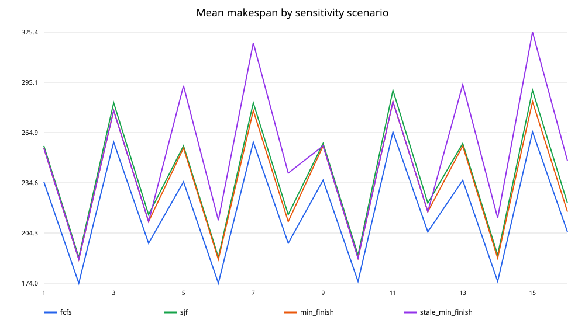
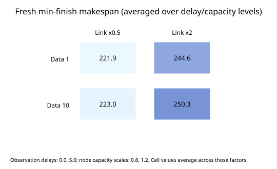

# Edge–Cloud Scheduling Sensitivity Analysis

## Executive summary

This report documents a controlled simulator sensitivity run, not a live Kubernetes experiment. It evaluates **16** configurations and **64,000** policy/workflow runs across the repository's 1,000 50-task test-array entries. All tasks completed in every recorded run: **True**.

Across scenarios, the unweighted average of scenario mean makespans was FCFS **218.471**, SJF **238.329**, fresh minimum-finish **234.974**, and stale minimum-finish **251.536**. The mean paired stale-vs-fresh minimum-finish penalty across scenarios was **16.562** time units. Scenario-averaging is descriptive; it does not pool individual DAGs into one inference.

## Research question and design

The experiment asks how heuristic makespan changes under selected assumptions about dependency payload size, network conditions, node capacity, and stale monitoring. Every policy sees the same workflow and resource configuration within a scenario. Fresh FCFS, SJF, and minimum-finish use exact current capacity; stale minimum-finish uses the configured delayed snapshot. Fixed seed base was 2300; there was one deterministic duration replicate per DAG, and no duration jitter.

The base cluster configuration in `configs/edge_cloud_dataset.json` has two nodes, each with CPU=100 and memory=100; Edge speed=0.8 and Cloud speed=1.5. The base link has latency=5 and bandwidth=10 in simulator units. Sensitivity scaling modifies these abstract inputs; none are measurements from physical nodes or links.

The factorial axes were:

| Factor | Tested values | Meaning |
|---|---:|---|
| Uniform data size per dependency | 1.0, 10.0 | Synthetic payload units assigned to each DAG edge |
| Observation refresh delay | 0.0, 5.0 | Simulator time units before stale free-capacity snapshot refresh |
| Link scale | 0.5, 2.0 | Multiplies latency and divides bandwidth; higher means slower links |
| Node capacity scale | 0.8, 1.2 | Multiplies each node's CPU and memory capacities |

This is a 16-cell full factorial grid. Each cell ran the same 1,000 DAG indices and all four policies. Bootstrap summaries use 500 resamples for descriptive intervals; the primary sensitivity comparison is the matched per-DAG output, available in the raw CSV.

## Results

| Policy | Mean of scenario means (time units) |
|---|---:|
| FCFS | 218.471 |
| SJF | 238.329 |
| Fresh minimum-finish | 234.974 |
| Stale minimum-finish | 251.536 |

The following marginal summaries average over all other grid dimensions. They are descriptive summaries, not a causal estimate outside these selected values.

### Payload size

| Level | fcfs | sjf | min_finish | stale_min_finish |
|---:|---:|---:|---:|---:|
| 1 | 216.584 | 236.171 | 233.294 | 249.698 |
| 10 | 220.358 | 240.486 | 236.653 | 253.373 |
### Observation delay

| Level | fcfs | sjf | min_finish | stale_min_finish |
|---:|---:|---:|---:|---:|
| 0 | 218.471 | 238.329 | 234.974 | 234.974 |
| 5 | 218.471 | 238.329 | 234.974 | 268.098 |
### Link scale

| Level | fcfs | sjf | min_finish | stale_min_finish |
|---:|---:|---:|---:|---:|
| 0.5 | 205.096 | 223.947 | 222.464 | 237.743 |
| 2 | 231.845 | 252.710 | 247.484 | 265.329 |
### Node capacity scale

| Level | fcfs | sjf | min_finish | stale_min_finish |
|---:|---:|---:|---:|---:|
| 0.8 | 248.895 | 272.068 | 268.496 | 288.156 |
| 1.2 | 188.046 | 204.589 | 201.452 | 214.915 |

The stale-vs-fresh comparison varies across the grid. The network heatmap averages fresh minimum-finish makespan over observation-delay and capacity levels for each data-size/link-scale pair; the policy figure plots the scenario means.





## Artifacts and reproduction

- Summary CSV: `results/sensitivity_test50_final.csv`
- Per-workflow raw CSV: `results/sensitivity_test50_raw.csv`
- Run log: `results/sensitivity_run.log`
- Figures: `results/sensitivity_policy_makespan.svg` and `results/sensitivity_network_heatmap.svg`
- Configuration: `configs/edge_cloud_dataset.json`
- Test suite: `python -m unittest discover -s tests -v`

Re-run the grid from the repository root in PowerShell:

```powershell
$python = Join-Path $env:LOCALAPPDATA 'venvs\cwscheduling-py312\Scripts\python.exe'
$env:PYTHONDONTWRITEBYTECODE = '1'
$indices = 0..999
& $python edge_cloud_experiment.py --config configs\edge_cloud_dataset.json --dataset-size 50 --dataset-split test --dataset-indices $indices --replicates 1 --seed 2300 --bootstrap-samples 500 --output results\sensitivity_test50.csv --sensitivity-raw-output results\sensitivity_test50_raw.csv --log-output results\sensitivity_run.log --sensitivity-data-sizes 1 10 --sensitivity-observation-delays 0 5 --sensitivity-link-scales 0.5 2 --sensitivity-node-capacity-scales 0.8 1.2
& $python generate_sensitivity_report.py --summary results\sensitivity_test50.csv --raw results\sensitivity_test50_raw.csv --report SENSITIVITY_ANALYSIS_REPORT.md --figure-dir results
```

## Limitations and interpretation

The repository does not establish that `npy/test_datasheet/50/` is an independently sampled or officially held-out split; its provenance remains undocumented. DAG arrays contain no edge payload volumes, so payload sizes are synthetic and uniform. Node capacities, link latency/bandwidth, scaling levels, and observation delay are simulation assumptions, not hardware/network measurements. CPU and memory are abstract units. The transfer model has no bandwidth contention or overlap, and stale observations omit noise, loss, and confidence. The policy set is small and the objective is makespan only.

Therefore, the experiment demonstrates sensitivity of this implementation to explicit parameters. It does **not** establish real-cluster behavior, a statistically general policy ranking, or a thesis contribution by itself. The unweighted averages across different parameter cells are summaries of the chosen grid, not a natural deployment distribution. Select parameter ranges from literature, measurement, or an explicitly justified scenario model before drawing research conclusions.

## Implementation and validation status

The simulator currently supports heterogeneous abstract nodes, DAG precedence, resource reservations, task-scoped pod records, configurable link delays, delayed free-capacity snapshots, and four heuristic variants. The generated artifacts preserve both scenario-level summaries and individual DAG/policy rows. The model remains a research prototype; reusable Kubernetes pods, multi-application arrivals, live Kubernetes, noisy telemetry, and a simulator-specific RL policy are not implemented.
