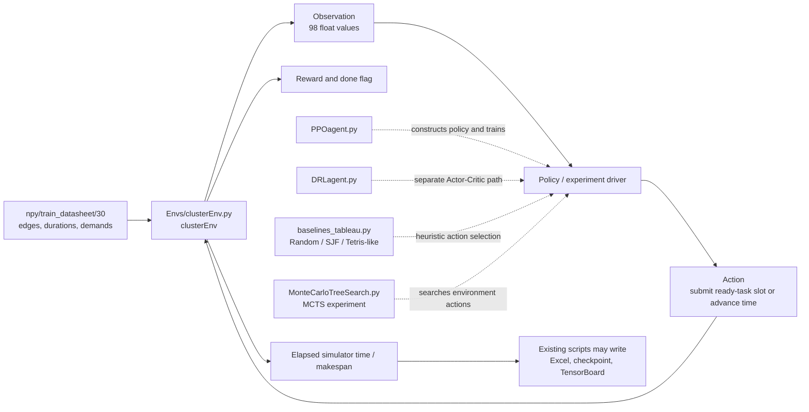
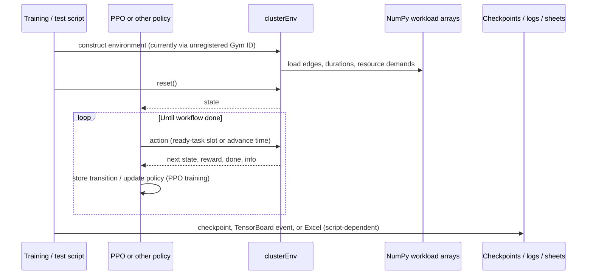
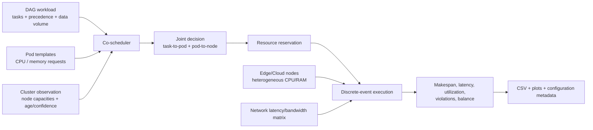

# System Architecture

## Status and evidence boundary

This document describes the original source and a separate research simulator. The simulator does not replace the original task-selection algorithm.

The original repository was created for cloud workflow scheduling with DAG precedence constraints. The primary verified simulator is `Envs/clusterEnv.py`, class `clusterEnv`. It models one abstract compute resource with fixed capacities of 100 CPU units and 100 memory units. It is not a Kubernetes deployment or a multi-node Edge–Cloud cluster.

## Implemented architecture

The diagram shows conceptual connections confirmed by source, not a fully runnable package. The root scripts call `gym.make()` for custom environment IDs, but the repository contains no registration module. PPO training also imports TensorBoard at module import time. These entry points have not been executed successfully.

## Main components and responsibilities

| Component | Implemented responsibility | Important files and symbols |
|---|---|---|
| Workload generation | Builds layered DAG edges, task durations, and CPU/memory demands; can serialize arrays. | `DAGs_Generator.py`: `DAGs_generate()`, `workflows_generator()`, `generate_train_datasheet()`, `generate_test_datasheet()` |
| Workload data | Stores generated train/test edge, duration, and demand arrays. | `npy/train_datasheet/<N>/`, `npy/test_datasheet/<N>/` |
| Scheduling environment | Loads arrays, initializes the single compute pool, tracks ready/running/completed jobs, validates task resource fit, and advances simulated time. | `Envs/clusterEnv.py`: `clusterEnv`, `reset()`, `step()`, `_update_ready_list()`, `_pend_task()`, `return_action_list()` |
| PPO policy | Uses an actor and critic MLP, categorical action sampling, rollout buffer, clipped surrogate update, and checkpoint saving. | `PPOagent.py`: `ActorCritic`, `RolloutBuffer`, `PPO.update()`, `train()` |
| GCN representation | Computes a graph-based task representation in an alternate environment. | `Envs/graphEnv.py`: `DecimaGNN`, `graphEnv`; `GCNutils/models.py`: `GCN` |
| Actor-Critic experiment | Separate policy/value models and training loop for another environment. | `DRLagent.py`: `Actor`, `Critic`, `compute_returns()`, `trainIters()` |
| Heuristic baselines | Implements Random, SJF, and Tetris-like action selection. | `baselines_tableau.py`: `randomagent()`, `sjf()`, `tetris()`, `alignment_score()` |
| Tree search | Clones/restores environment state and searches candidate action sequences with rollouts. | `MonteCarloTreeSearch.py`: `TreeNode`, `MCTS`; related experiment code in `AblationExperiment.py` |
| Experiment artifacts | Existing checkpoint, event, spreadsheet, and image files. | `runs/`, `models/`, `data/`, `figure/` |

`Envs/graphEnv.py` imports `Envs.utils`, which is absent, and uses original-author absolute dataset paths. The source also depends on GCN weight files under `GCN_initialization/`. That variant is not presently verified as executable.

## Workload representation and DAG dependencies

Each workflow is represented as:

- `edges`: directed pairs such as `(parent_task, child_task)`, with synthetic `"Start"` and `"Exit"` vertices;
- `duration`: a duration value for each numbered task;
- `demand`: a pair of CPU and memory demands for each task.

The generated graph is layered. `_update_ready_list()` in `clusterEnv` makes a task ready when its parents appear in `done_job`. The two sentinel vertices are used for graph traversal and are not ordinary compute tasks.

### Source versus README detail

Some workload-generation details in the README differ from active source:

- The README describes CPU-heavy versus memory-heavy task categories, but the active demand-generation loop in `DAGs_Generator.py` draws both CPU and memory demands from the same `0.25r`–`0.5r` range. The asymmetric demand code is commented out.
- In default generator mode, `args.prob` is set to `1`, so durations are sampled from the short-duration branch. The non-default mode uses `0.9`; this differs from the README's stated 80%/20% long-tail model.
- The committed datasets were not regenerated for this analysis; their actual values are the input to smoke tests.

Consequently, workload assumptions should be taken from active code and checked against the stored arrays, not inferred solely from README prose.

## Environment state, action, transition, and reward

### State

With `M = 30`, `clusterEnv.return_dim_info()` returns state dimension `3 + 3M + 5 = 98` and action count `M + 1 = 31`. The state is assembled from:

1. elapsed simulation time;
2. remaining CPU and memory capacity on the one resource pool;
3. 30 ready-task duration slots;
4. 30 ready-task CPU-demand slots;
5. 30 ready-task memory-demand slots;
6. b-level / longest remaining DAG path and downstream node-count features;
7. aggregate duration and resource demands for ready tasks beyond the fixed 30-slot observation window.

An empty slot is represented by `-1`. The state does not identify a cluster node, pod, network path, application priority, monitoring age, or stale estimate.

### Action

The scripts map categorical action indices `0..30` to environment actions `-1..29` by subtracting one:

- `-1`: complete the pending job with the least remaining duration and advance the simulation clock;
- `0..29`: submit the ready task in the corresponding observation slot if resource fit and readiness checks pass.

Invalid action attempts return `info[0] == False`. Several policy scripts resample until they find an action accepted by the environment.

### Transition and execution model

When a task is submitted, its resource demands are subtracted from the single pool and its duration is recorded as pending. When time advances, the environment completes the pending task with the smallest remaining duration, advances by that remaining duration, releases resources, and recalculates DAG readiness. On the terminal branch, it returns before releasing the final task's resources or removing it from the pending-task structures; those fields are therefore not a fully cleaned-up terminal state.

The terminal observation timestamp was corrected in this branch to report the final simulator time. The final completion still returns reward `0`, unlike ordinary time-advance transitions which return `-time_shift / t_unit`. Thus final RL return accounting omits the final time increment; no new RL result should be interpreted until this behavior is addressed deliberately. This terminal resource/task cleanup asymmetry should also be resolved or explicitly accounted for before adding simulator invariants or RL evaluation.

## Training, evaluation, and outputs

`PPOagent.py` defines a 64-64 MLP actor and critic, categorical actions, PPO clipping parameter `0.2`, discount factor `0.99`, 80 update epochs, and training target `300,000` timesteps. It sets updates every 1,000 steps and saves a checkpoint every 5,000 steps. These are source defaults, not independently validated recommended values.

`PPOtest.py` selects a checkpoint name in source and schedules 1,000 test episodes in batches of ten. It writes `data/makespan_PPO.xls`. Neither full training nor this evaluation has been run in the current environment.

## Separate Edge–Cloud simulator prototype

`Envs/edge_cloud_simulator.py` implements a deterministic discrete-event model over heterogeneous Edge/Cloud nodes. Tasks carry duration and CPU/memory requests, dependencies may carry data size, and selected tasks receive one task-scoped pod record. Placement reserves capacity until task completion; the pod record tracks its node and pending/running/completed state. This is a simulator abstraction, not a Kubernetes API client or container runtime.

Fresh-state policies are FCFS, SJF, and minimum estimated finish. A stale minimum-finish variant uses a fixed-delay cached view of free CPU/memory; physical feasibility is still checked before a task is admitted. Stale waiting time is reported. The model does not include telemetry noise/loss, pod reuse, bandwidth contention, transfer overlap, cluster arrivals, failures, or real Kubernetes behavior. The JSON experiment runner and 17-unit-test suite live in `edge_cloud_experiment.py` and `tests/test_edge_cloud_simulator.py`. See `PROPOSED_APPROACH.md` and `SENSITIVITY_ANALYSIS_REPORT.md` for assumptions, tested commands, and carefully qualified exploratory outputs.

### Implemented simulator decision flow

The current simulator uses task readiness, duration, CPU/memory requests, optional tier eligibility, and per-dependency payload assumptions. Each node has a tier, capacity, speed, and configured links. Admission checks physical CPU/memory feasibility; completion releases resources. Transfer release and observation refresh are separate simulated events. Pods remain one-record-per-task and are not reusable Kubernetes workloads.

The present policies are FCFS, SJF, estimated-finish, and estimated-finish using stale free-capacity snapshots. The original repository's single-pool policy has not been compared under an equivalent cluster model. A learned policy remains a research option, not an implemented result.

## Explication simple en français

- **DAG** : imagine des tâches reliées par des flèches. Si `A -> C`, la tâche C attend la fin de A. Deux tâches sans dépendance peuvent avancer en parallèle.
- **État du code original** : il décrit une seule machine abstraite. Le simulateur Edge–Cloud séparé représente plusieurs nœuds abstraits, sans machines réelles.
- **Action** : choisir une tâche prête à lancer, ou demander au simulateur d’avancer le temps jusqu’à la fin d’une tâche en cours.
- **Pourquoi la taille d’état vaut 98** : 3 valeurs globales + 30 durées + 30 demandes CPU + 30 demandes mémoire + 5 valeurs de synthèse = 98.
- **Pod simulé** : un enregistrement de ressources associé à une seule tâche; ce n'est pas un objet Kubernetes et il ne peut pas être réutilisé.
- **Co-ordonnancement simulé** : le prototype choisit une tâche prête et un nœud, puis réserve CPU/mémoire. Le code original ne choisit pas de nœud.

## Limitations and validation status

**Verified:** direct `clusterEnv.reset()`/`step()` smoke test; one complete 30-task episode; one SJF-helper episode; syntax parsing of 21 Python source files; `pip check` in the compatibility venv.

**Not verified:** PPO convergence, GCN performance, MCTS results, full script outputs, all existing artifact provenance, and compatibility with the README's original package versions.

**Original-environment limits:** single resource pool; no pod model; no heterogeneous nodes; no Edge/Cloud tiers; no network model; no stale cluster information. **Separate-simulator limits:** no reusable pods, multiple applications, bandwidth contention, transfer overlap, telemetry noise/loss, or live Kubernetes scheduler/API. The original environment's terminal branch reports makespan but leaves the final task in internal pending structures and does not release its resources.
